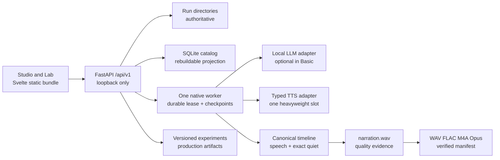

# Local V1 Architecture

Whoopy Local V1 is one self-hosted browser product around a durable native generation engine. The
public Commons concept, accounts, cloud services, mobile generation, ambience, and publishing are
outside this architecture.

## Runtime Shape



`whoopy app` composes these pieces, reconciles interrupted state, binds to `127.0.0.1`, serves the
bundled frontend, and opens the browser. `whoopy web` is only a legacy alias.

## Product Surfaces

### Studio

Studio presents reviewed defaults and safe controls:

- prompt or authored-script creation;
- requested duration and meditation kind;
- only model paths proven ready on this machine;
- typed delivery and pace intentions;
- durable progress/cancel/resume;
- searchable local library;
- Plan, Script, Timeline, Delivery, and Listen views;
- immutable revisions, restore, and selective rerender;
- recoverable deletion and verified finished exports.

The frontend never implements generation rules. It calls `/api/v1`, renders durable state, and
plays or downloads saved artifacts.

### Lab

Lab uses the same adapters, generation paths, timelines, revisions, and audio files as Studio. Its
domain supports five controlled comparisons:

1. LLM with prompt, seed, schema, and blueprint held constant;
2. writing method with model inputs held constant;
3. voice with text and silence held constant;
4. delivery style/intensity with text, silence, voice identity, language, mode, and pace held
   constant;
5. pacing with script and voice held constant.

Experiments are versioned and sequential, not a full Cartesian product. Results retain automatic
metrics without a hidden combined score, blind presentation assignments, human 1–5 ratings,
baseline comparisons, and promotion/rejection decisions. The bundled Lab creates a one-case
experiment and starts the default `LocalProductionExperimentExecutor`, which launches the same
durable child-process generation path as Studio. A candidate condition the production pipeline does
not expose becomes durable failed-trial evidence instead of a simulated result.

## Security Boundary

The local API:

- accepts only `127.0.0.1` or `localhost` hosts;
- uses Trusted Host validation;
- rejects cross-origin mutations;
- bounds ordinary and voice-reference request bodies;
- validates UUIDs, segment IDs, revision IDs, and managed paths;
- sends no-store, content-type, and content-security response headers;
- exposes no cloud endpoint.

Loopback is a privacy boundary, not an authentication system. Other software running as the same OS
user may still read accessible files or attempt loopback requests. Operating-system account and
disk security remain relevant.

## Durable Source Of Truth

Each run directory is authoritative:

```text
runs/<uuid>/
├── run.json
├── generation-request.json       # prompt mode before planning
├── plan.json                     # generated mode
├── raw-model-output/             # preserved attempts
├── draft-sections/               # accepted section checkpoints
├── script.md
├── resolved-config.json
├── model-metadata.json
├── timeline.json
├── segments/<segment-id>/        # verified speech checkpoints
├── narration.wav
├── audio-manifest.json
├── quality.json
├── revisions/
├── exports/
└── worker.log / events.jsonl
```

`run.json` records queued, running, interrupted, failed, or completed state plus ownership, stage,
heartbeat, lease, progress, recovery counters, and a durable `studio`, `lab`, or `system` audience.
A process death cannot make a partial output look complete because artifact references are committed
only after validation. The audience keeps production-backed experiments and acceptance diagnostics
out of the everyday Studio library without deleting or weakening their evidence.

The SQLite file at `runs/.whoopy-catalog.sqlite3` accelerates library search, stores local UI
settings, and projects version-keyed Lab experiments, ratings, and decisions. Lab JSON under
`runs/.whoopy-lab/` remains authoritative. Startup and Lab mutations atomically rebuild the
disposable projection; schema upgrades discard only those derived Lab rows while preserving run
and settings data.

## Generation Pipeline

### 1. Hardware and model truth

Hardware inspection normalizes the current operating system/architecture, measures live RAM and
disk, and records available CPU/Metal/CUDA capabilities. Release acceptance additionally probes a
working Vulkan loader. A quality profile is selected before a precise model.

Model readiness has three separate layers:

1. pinned files and extracted trees match their expected hashes;
2. the isolated runtime starts on this machine/revision;
3. a current, offline, real synthesis returns valid audible PCM.

Only the third state is `ready`. Heavy models share one kernel-backed slot and are loaded
sequentially.

### 2. Meditation Engine V2

Prompt mode first selects one reviewed, versioned blueprint. A plan describes the technique,
arrival, practice development, ending, purpose of each spoken block, silence intent, breath mode,
and delivery intent.

The LLM supplies bounded prose. It cannot invent pause durations, breath ratios, holds, or an
unsupported exercise. Editorial checks cover request fidelity, repetition, vague reassurance,
abrupt transitions, unsafe claims, excessive narration, and incorrect daytime/sleep endings.
Rejected sections can be regenerated without discarding accepted sections or raw evidence.

### 3. Canonical typed timeline

The compiler converts accepted script controls into typed events:

- `SPEECH`: clean text plus delivery, intensity, language, voice mode, pace, and pronunciation
  metadata;
- `SILENCE`: exact milliseconds with deterministic intent/allocation upstream;
- `BREATH`: reviewed inhale or exhale event, exact milliseconds, cycle, and protocol ID.

Bracket controls such as `[delivery: calm]` never remain in speech text. Unknown bracket controls
fail compilation. Model-native pause markup does not replace exact timeline silence.

### 4. Segment synthesis, cache, and recovery

Each speech adapter declares honest capabilities and translates typed intent independently. Every
control that can change audio is part of adapter metadata, the cache identity, and run evidence.

Speech segments are synthesized independently. The shared content-addressed cache and per-run
checkpoint store validate metadata and PCM hashes before reuse. Transient failures retry within a
bound; fatal or invalid-audio failures remain actionable. Heartbeats renew an active lease; expired
leases reconcile to a resumable interruption. Release acceptance can opt into an otherwise dormant
stage observer: only after `run.json` contains the new stage does it write a PID/run/stage marker and
pause for the harness to terminate it. Recovery validation hashes healthy work before and after the
restart; corrupt checkpoint or cache PCM is treated as a miss and regenerated rather than trusted.

### 5. Deterministic assembly, encoding, and QC

The renderer assembles normalized mono 24 kHz signed 16-bit speech with exact silence/breath frames.
The audio manifest maps every timeline event to exact frame ranges and hashes. Quality inspection
checks sample format, requested quiet timing, whole/segment hashes, audible signal, headroom,
clipping, and joins before the run becomes completed.

### 6. Revisions and selective rerender

An edit creates an immutable revision, validates it, atomically activates it, and leaves earlier
revisions restorable. Silence-only changes require assembly; delivery changes invalidate affected
speech; script changes compare segment identities. Healthy checkpoint/cache work remains reusable.

### 7. Finished export activation

`narration.wav` remains the master. FFmpeg encodes PCM WAV, FLAC, AAC in M4A, and Opus into a sibling
staging directory. FFprobe verifies expected codec, duration, channels, and metadata; FFmpeg fully
decodes each output; SHA-256 values are saved. The complete directory is activated only after
`export-manifest.json` is durable. Existing exports are restored if activation fails.

## Ports And Adapters

Domain code depends on typed ports rather than model names. An adapter owns:

- model/runtime/license metadata;
- accepted voice modes, delivery styles, pace intents, languages, and instructions;
- prompt or request translation;
- process startup, bounded diagnostics, timeout, and cleanup;
- output PCM validation and device evidence;
- a cache identity covering every output-affecting setting.

Kokoro is the portable preset-voice path. Fish, MOSS, and Qwen3-TTS variants are optional expressive
adapters with narrower contracts. See [model capabilities](model-capabilities.md).

## Offline Behavior

Network access is an explicit acquisition concern, not an inference dependency. Defaults disable
remote fallback. After packages and model packs are installed, Studio, generation, editing,
evaluation artifacts, playback, and exports operate locally.

The release audit distinguishes:

- configured offline policy;
- real offline smoke evidence for required models;
- an operator assertion that the OS network was disabled during testing;
- end-to-end scenarios run on this exact target.

It never infers that another target passed. The release matrix contains Windows x64, macOS
ARM64/x64, and Linux ARM64/x64; unrun entries remain `not_run`.

## Deliberate Exclusions

Local V1 produces narration-only meditations. Ambience/music configuration that survives in older
configuration or design notes is not connected to the shipped workflow. Commons, accounts, mobile
model execution, cloud generation, and public publishing are later product decisions and cannot be
required by the local pipeline.

## Historical Architecture Notes

The phase documents and old diagrams describe intermediate fixture workers, dependency-free tester
pages, proposed Huey queues, ambience, or public publishing. They are retained to explain design
decisions, but they are not current architecture. In particular, Local V1 reuses the durable worker
and filesystem store; it does not add Huey, Redis, Postgres, Docker, or a separate Node process.
